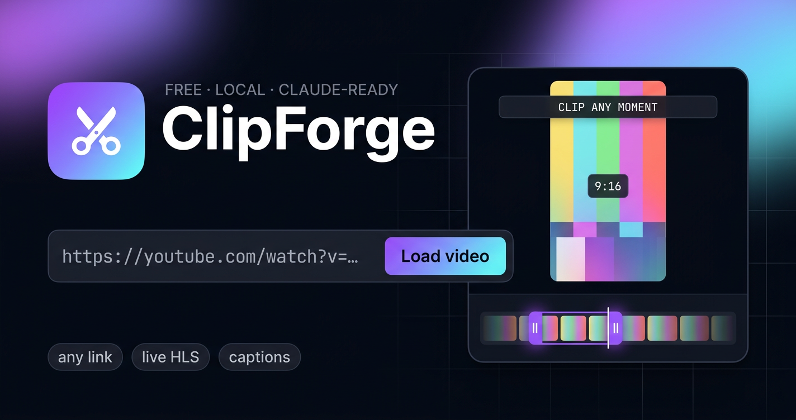

# ✂ ClipForge



**A free, fully local video clipper — paste any link, cut any moment, keep the clip.**
No accounts, no credits, no watermarks, no uploads. Just ffmpeg on your machine,
plus an **MCP server so Claude Code can clip for you**.

```
any link ──▶ resolve ──▶ preview ──▶ pick in/out ──▶ MP4 on your disk
             (YouTube, Vimeo, Twitch, MP4, HLS/DASH, live streams)
```

---

## Quick start

```bash
git clone <this repo> clipforge && cd clipforge
npm install
npm run setup      # downloads portable ffmpeg + yt-dlp into .tools/ (no sudo)
npm run dev        # → http://127.0.0.1:3000
```

Then paste a link in the Studio tab, drag the handles, and hit **Cut clip**.

**Connect Claude Code** (one command, from the repo root):

```bash
claude mcp add clipforge -- npx -y tsx mcp/server.ts
```

Start `claude`, say **“connect to ClipForge and clip 0:12–0:48 of <link> as a 9:16 clip”**.
That's it — no API keys, no cloud.

> `npm run smoke` runs a real end-to-end test (probe → clip → live record) and
> `npm run doctor` prints exactly what your machine supports.

---

## What it does

| | |
| --- | --- |
| **Any link** | YouTube, Vimeo, Twitch, Kick, Facebook, X… pages via yt-dlp; direct `.mp4/.webm/.mov`; HLS `.m3u8`; DASH `.mpd`; existing library clips |
| **Live streams** | Detects live HLS/DASH and page lives, previews them through a local proxy, records N seconds from the live edge, then clips the buffer |
| **Any moment** | Scrub timeline with dual in/out handles, timecode inputs (`90`, `1:30`, `01:02:03`), quick actions, preview frames |
| **Social formats** | 9:16, 1:1, 4:5, 16:9, 4:3 — smart center-crop to fill, 1080-class output |
| **Captions** | Burned in with libass: 6 styles (clean, bold, karaoke, highlight, neon, minimal). Paste SRT/VTT for exact sync, or plain text and ClipForge times it for you |
| **Fast** | Stream-copy cuts when possible (keyframe-aware), full re-encode only when cropping or adding captions |
| **Local & free** | Everything lands in `.data/`; nothing leaves your machine. MIT licensed |

---

## Connect Claude Code

### 1. Register the MCP server

The repo already contains `.mcp.json`, so a Claude Code session started in this
directory offers the `clipforge` server automatically. Prefer the CLI?

```bash
claude mcp add clipforge -- npx -y tsx mcp/server.ts
```

<details>
<summary>Or paste this into your MCP config</summary>

```json
{
  "mcpServers": {
    "clipforge": {
      "command": "npx",
      "args": ["-y", "tsx", "mcp/server.ts"],
      "cwd": "/absolute/path/to/this/repo",
      "env": {
        "CLIPFORGE_ENGINE_URL": "http://127.0.0.1:3000",
        "CLIPFORGE_AUTOSTART": "1"
      }
    }
  }
}
```
</details>

The MCP server is a thin client over the same local engine the Studio uses.
If the engine isn't running, it starts it for you (`CLIPFORGE_AUTOSTART=1`).

### 2. Tools Claude gets

| Tool | What it does |
| --- | --- |
| `check_engine` | Ping the engine; report ffmpeg / ffprobe / yt-dlp health |
| `probe_video` | Any link → title, duration, resolution, fps, **is-live**, playable? |
| `clip_video` | Cut a clip by link or clip id; aspect, captions, styles |
| `record_live` | Record N seconds of a live stream to a local MP4 |
| `list_clips` | Browse the library |
| `get_clip` | Full metadata + absolute path |
| `delete_clip` | Delete file + index entry |

### 3. Things to say

```
Connect to ClipForge and check the engine.
Clip https://youtu.be/dQw4w9WgXcQ from 0:42 to 1:10 as a 9:16 clip with bold captions:
"Never gonna give you up / Never gonna let you down"

This stream is live — https://example.com/live.m3u8 — record 60 seconds,
then cut the most interesting 15 seconds as a square clip.

List my clips, and delete anything older than a week.
```

`CLAUDE.md` in this repo tells Claude exactly how to use the tools, so a fresh
session needs no extra coaching.

---

## Live video

```
Live tab ──▶ paste .m3u8 / .mpd / Twitch / YouTube-live link
         ──▶ preview plays through /api/media-proxy (rewrites playlists + segments)
         ──▶ “Record 60s” → ffmpeg captures the live edge → .data/live/*.mp4
         ──▶ Studio ▸ load the recording ▸ cut the moment
```

Everything is streamed through the local server, so it works even when the CDN
blocks the browser (CORS, signed URLs, Referer checks).

**Try it without any external service:**

```bash
npm run demo:live        # serves a rolling HLS stream on :8080
# paste  http://127.0.0.1:8080/live.m3u8  into the Live tab
```

---

## HTTP API

The UI and the MCP server both use these endpoints, so you can script ClipForge
with `curl`, Python, or anything else.

```bash
# inspect any link
curl -s localhost:3000/api/probe -H 'content-type: application/json' \
  -d '{"url":"https://youtu.be/VIDEO"}'

# cut a clip (blocks until the MP4 exists)
curl -s localhost:3000/api/clips -H 'content-type: application/json' \
  -d '{"source":"https://youtu.be/VIDEO","start":"0:12","end":"0:48",
       "aspect":"9:16","captions":"first line\nsecond line","captionStyle":"bold"}'

# record 60s of a live stream
curl -s localhost:3000/api/live -H 'content-type: application/json' \
  -d '{"url":"https://example.com/live.m3u8","durationSec":60}'

# library
curl -s localhost:3000/api/clips

# live progress feed (Server-Sent Events)
curl -N localhost:3000/api/tasks?stream=1
```

| Method | Endpoint | Purpose |
| --- | --- | --- |
| `GET` | `/api/health` | Binaries, data dir, capabilities |
| `POST` | `/api/probe` | Resolve any link |
| `POST` | `/api/clips` | Create a clip |
| `GET` | `/api/clips` | List library |
| `GET`/`DELETE` | `/api/clips/:id` | Read / delete one clip |
| `GET` | `/api/clips/:id/file` | Stream MP4 (Range support, `?download=1`) |
| `GET` | `/api/live?url=` | Is it live? playable URL |
| `POST` | `/api/live` | Record N seconds |
| `GET` | `/api/tasks?stream=1` | SSE task progress |
| `GET` | `/api/frame?url=&t=` | Preview frame JPEG |
| `GET` | `/api/media-proxy?u=` | CORS/Range-safe media + HLS proxy |
| `GET` | `/api/media/:name` | Serve clips / recordings |

---

## How it works

```
                 ┌─────────────── Studio (Next.js, client) ───────────────┐
 paste link ──▶  │ probe → HLS.js preview → timeline → caption editor     │
                 └───────────────┬───────────────────────────────────────┘
                                 │ JSON / SSE
                 ┌───────────────▼──────────── lib/ (engine, Node) ───────┐
                 │ media.ts    resolve: yt-dlp | ffprobe | ffmpeg        │
                 │ clipper.ts  cut: copy | x264 + libass, crop, remux    │
                 │ tasks.ts    progress events (SSE)                     │
                 └───────────────┬───────────────────────────────────────┘
                                 │
                     ffmpeg/ffprobe/yt-dlp (portable, in .tools/)
                                 │
                       .data/{clips,downloads,live}
```

- **Cuts** are stream-copied when the in-point sits on a keyframe; otherwise the
  stream is re-encoded at `crf 20 / veryfast`. Cropping and captions always re-encode.
- **Remote links** are either downloaded once (best for repeats) or seeked
  directly by ffmpeg, so you can clip a 2-hour video without waiting for a full download.
- **Live** uses the HLS demuxer with a rolling manifest and a `-t` cap; the
  fragmented output is remuxed to a seekable MP4.

---

## Privacy & limits

- **Nothing uploads.** Clips, downloads and recordings are files in `.data/`.
- **No DRM.** ClipForge cannot (and won't try to) bypass protected streams.
- **Be a good citizen.** Only clip content you have the rights to; respect the
  terms of the sites you use.
- Public sources only for the proxy (SSRF guard). Set `CLIPFORGE_ALLOW_PRIVATE=1`
  to clip LAN devices such as IP cameras.

## Configuration

Copy `.env.example` to `.env` if you need overrides.

| Variable | Default | Meaning |
| --- | --- | --- |
| `FFMPEG_BIN` / `FFPROBE_BIN` / `YTDLP_BIN` | auto | Explicit binary paths |
| `CLIPFORGE_DATA` | `.data` | Where clips are stored |
| `FFMPEG_FONT` | auto-detected | TrueType font for captions |
| `CLIPFORGE_LIVE_MAX_SEC` | `7200` | Max live recording length |
| `CLIPFORGE_ENGINE_URL` | `http://127.0.0.1:3000` | Engine the MCP server talks to |
| `CLIPFORGE_AUTOSTART` | `1` | Let the MCP server start the engine |

## Project layout

```
app/            Studio page + HTTP API route handlers
components/     Player (HLS.js), timeline, clip cards, views
lib/            Engine: resolution, cutting, captions, tasks, library
mcp/server.ts   MCP server (stdio) — the Claude Code connector
scripts/        setup.sh · doctor.ts · smoke.mjs · demo-live.mjs
public/demo/    30-second demo video for the built-in sample link
```

## Troubleshooting

| Symptom | Fix |
| --- | --- |
| `yt-dlp is not installed` | `npm run setup` (or `pipx install yt-dlp`), then restart |
| Page link fails with “Sign in to confirm…” | yt-dlp is out of date: `yt-dlp -U` (or re-run setup) |
| Preview is black but the clip works | Stream blocks browsers; you can still cut it (in/out inputs) |
| Captions missing | No TrueType font found — install `fonts-dejavu` or set `FFMPEG_FONT` |
| `Port 3000 is in use` | `PORT=3010 npm run dev` and set `CLIPFORGE_ENGINE_URL` for MCP |
| Claude can't see the tools | Run `claude mcp list`; the `cwd` in your config must be this repo |

## License

MIT — do what you want; attribution appreciated.
